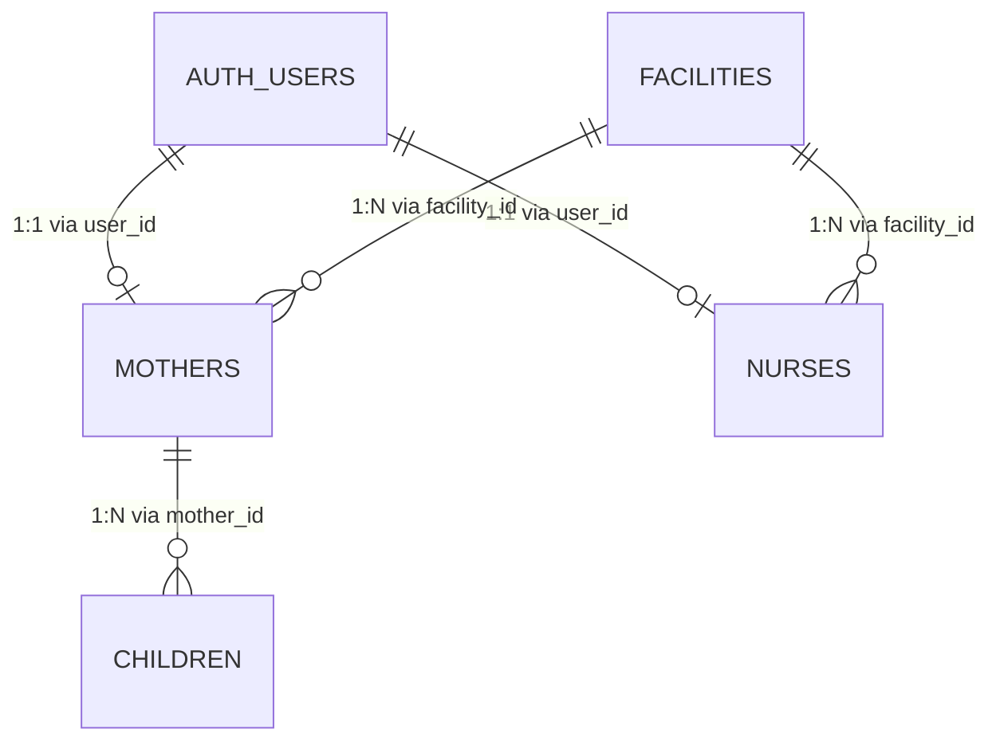
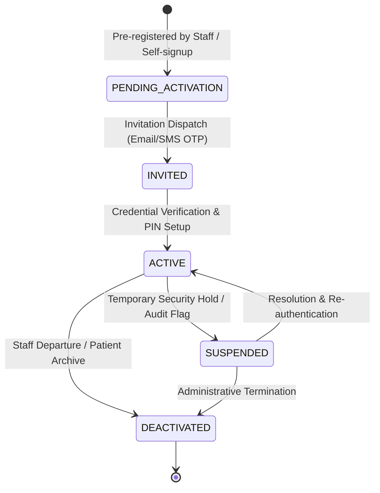

# TOTOAFYA DIGITAL — IDENTITY & ACCOUNT MODEL SPECIFICATION

**Document ID:** `DOC-SEC-AUTH-02`  
**Version:** `1.0.0-PROD-SPEC`  
**Status:** `DRAFT FOR REVIEW / IMPLEMENTATION FROZEN`  
**Classification:** `CONFIDENTIAL — HEALTHCARE SECURITY ARCHITECTURE`  
**Target System:** TotoAfya Digital Production Platform  
**Location:** `docs/security/auth-authorization/02-IDENTITY-ACCOUNT-MODEL.md`  

---

## 1. Canonical Identity Taxonomy

In TotoAfya Digital, identity is strictly separated into cryptographic authentication principals (`auth.users`), domain profile principals (`mothers`, `nurses`), and contextual entity scopes (`facilities`).

### 1.1 Identifier Definitions

| Identity Element | Technical Representation | Source of Truth | Mutability | Security Property |
| :--- | :--- | :--- | :--- | :--- |
| **Canonical User ID** | `UUIDv4` | `auth.users.id` | Immutable | Cryptographic identity issued by Supabase Auth engine |
| **Caregiver Profile ID** | `UUIDv4` | `public.mothers.id` | Immutable | Primary key of clinical maternal record |
| **Staff Profile ID** | `UUIDv4` | `public.nurses.id` | Immutable | Primary key of clinical provider / admin record |
| **Child Entity ID** | `UUIDv4` | `public.children.id` | Immutable | Primary key of pediatric record bound to `mother_id` |
| **Facility ID** | `UUIDv4` | `public.facilities.id` | Immutable | Primary key of health facility multi-tenant boundary |
| **County Scope** | `TEXT` | `public.facilities.county` | Administrative | Geographic governance scope (47 Kenyan Counties) |

### 1.2 Identity Disambiguation & Non-Identity Anti-Patterns

The following attributes are business identifiers or authentication credentials; they **MUST NEVER BE TREATED AS CANONICAL IDENTITY**:

1. **`email` != Identity** `[PROVEN FROM CODE/DB]`: Email addresses can change, be spoofed in synthetic generation, or be shared across clinic administrative accounts.
2. **`national_id` != Identity** `[PROVEN FROM CODE/DB]`: Kenyan National ID is a government domain attribute used for lookup, not an authentication principal.
3. **`anc_number` != Identity** `[PROVEN FROM CODE/DB]`: Antenatal Care registration number is facility-specific and non-globally unique across private health centers.
4. **`localStorage` User Object != Identity** `[PROVEN FROM CODE]`: Client-side JavaScript memory (`localStorage.setItem('custom_mock_user')`) is completely untrusted user controlled state.
5. **Frontend Role String != Identity** `[PROVEN FROM CODE]`: URL params (`?role=admin`) or client state variables carry zero security authority.

---

## 2. Comprehensive Account Type Specification

TotoAfya Digital supports eight distinct account classes. Each account type is formally specified below:

### 2.1 Caregiver / Mother Account (`mother`)
- **Primary Identity Source**: `auth.users.id` linked 1:1 with `public.mothers.user_id`.
- **Authentication Method**: Phone / National ID / ANC Number + 6-digit PIN (hashed).
- **Profile Table**: `public.mothers`.
- **Default Role**: `user`.
- **Default Scope**: `self` (Access restricted strictly to own profile and owned children records).
- **Provisioning Authority**: Pre-registered by Nurse at Facility intake OR self-registered via caregiver portal.
- **Deactivation Behavior**: Soft-disabled in `auth.users`; profile retained for statutory clinical record retention compliance.

### 2.2 Community Health Volunteer Account (`chv`)
- **Primary Identity Source**: `auth.users.id` linked 1:1 with `public.nurses.user_id`.
- **Authentication Method**: Phone / Email + Secure Password / OTP.
- **Profile Table**: `public.nurses` (where `role = 'chv'`).
- **Default Role**: `chv`.
- **Default Scope**: `facility` + assigned community units (`sub_county` / village).
- **Provisioning Authority**: Facility Administrator or County Admin.
- **Deactivation Behavior**: Deactivated by Facility Admin; immediately revokes field sync access.

### 2.3 Nurse Account (`nurse`)
- **Primary Identity Source**: `auth.users.id` linked 1:1 with `public.nurses.user_id`.
- **Authentication Method**: Clinical Email + Password OR NFC Badge Token + Clinical PIN.
- **Profile Table**: `public.nurses` (where `role = 'nurse'`).
- **Default Role**: `nurse`.
- **Default Scope**: `facility` (Assigned facility clinical records).
- **Provisioning Authority**: Facility Administrator.
- **Deactivation Behavior**: Deactivated by Facility Admin; active JWT sessions invalidated.

### 2.4 Clinician / Doctor Account (`doctor`)
- **Primary Identity Source**: `auth.users.id` linked 1:1 with `public.nurses.user_id`.
- **Authentication Method**: Email + Multi-Factor Authentication (MFA).
- **Profile Table**: `public.nurses` (where `role = 'doctor'`).
- **Default Role**: `doctor`.
- **Default Scope**: `facility` + cross-referral view permissions.
- **Provisioning Authority**: Facility Administrator or Medical Superintendent.
- **Deactivation Behavior**: Deactivated by Facility Admin.

### 2.5 Facility Administrator Account (`facility_admin`)
- **Primary Identity Source**: `auth.users.id` linked 1:1 with `public.nurses.user_id`.
- **Authentication Method**: Official Staff Email + MFA.
- **Profile Table**: `public.nurses` (where `role = 'admin'`).
- **Default Role**: `facility_admin` (Normalized from legacy `'admin'`).
- **Default Scope**: `facility` (Full operational management of single health facility).
- **Provisioning Authority**: County Administrator or Super Admin.
- **Deactivation Behavior**: Deactivated by County Admin; requires successor assignment.

### 2.6 County Administrator Account (`county_admin`)
- **Primary Identity Source**: `auth.users.id` linked 1:1 with `public.nurses.user_id`.
- **Authentication Method**: County Government Email + Mandatory Hardware/TOTP MFA.
- **Profile Table**: `public.nurses` (where `role = 'county_admin'`).
- **Default Role**: `county_admin`.
- **Default Scope**: `county` (Read-only aggregate & audit access to all facilities in assigned county).
- **Provisioning Authority**: MOH Administrator or Super Admin.
- **Deactivation Behavior**: Deactivated by Super Admin.

### 2.7 Ministry of Health (MOH) Admin Account (`moh_admin`)
- **Primary Identity Source**: `auth.users.id` linked 1:1 with `public.nurses.user_id`.
- **Authentication Method**: National Government SSO / Email + MFA.
- **Profile Table**: `public.nurses` (where `role = 'moh_admin'`).
- **Default Role**: `moh_admin`.
- **Default Scope**: `national` (Read-only aggregate analytics across all 47 counties).
- **Provisioning Authority**: Super Admin.
- **Deactivation Behavior**: Deactivated by Super Admin.

### 2.8 Super Administrator Account (`super_admin`)
- **Primary Identity Source**: `auth.users.id` linked 1:1 with `public.nurses.user_id` AND explicit entry in `public.user_roles` table.
- **Authentication Method**: Hardware Security Key (FIDO2/WebAuthn) + IP Whitelist.
- **Profile Table**: `public.nurses` (where `role = 'super_admin'`).
- **Default Role**: `super_admin`.
- **Default Scope**: `global` (Break-glass system administration, security audit, facility management).
- **Provisioning Authority**: Root System Provisioning CLI only `[REQUIRES PRODUCT DECISION]`.
- **Deactivation Behavior**: Cannot deactivate last active Super Admin; immutable audit trail for all actions.

---

## 3. Account Lifecycle & Canonical State Machine

Accounts across all categories MUST strictly transition through five deterministic states:

### 3.1 State Machine Rules & Authorization Behavior

| State Name | Allowed Transition To | Trigger Authority | Auth Behavior | RLS Behavior |
| :--- | :--- | :--- | :--- | :--- |
| **`PENDING_ACTIVATION`** | `INVITED`, `DEACTIVATED` | System Trigger, Facility Admin | Login Denied (`HTTP 403`) | Zero RLS access |
| **`INVITED`** | `ACTIVE`, `DEACTIVATED` | Target User (via OTP/Token) | Limited Activation Token | Write restricted to setting credentials |
| **`ACTIVE`** | `SUSPENDED`, `DEACTIVATED` | System, Facility Admin | Full Authentication Allowed | Normal role & scope RLS enforced |
| **`SUSPENDED`** | `ACTIVE`, `DEACTIVATED` | Security Officer, Admin | Refresh Tokens Revoked (`HTTP 401`) | Immediate zero data return |
| **`DEACTIVATED`** | None (Terminal State) | Super Admin | Auth Blocked (`auth.users.banned_until`) | Zero data return; records archived |

---
*End of Document 02 — Identity & Account Model Specification.*
