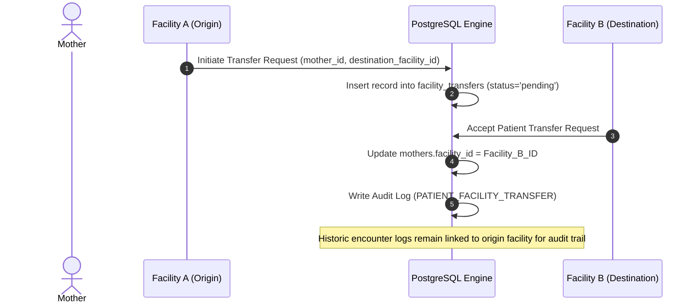

# TOTOAFYA DIGITAL — TENANCY & DATA ACCESS SPECIFICATION

**Document ID:** `DOC-SEC-AUTH-04`  
**Version:** `1.0.0-PROD-SPEC`  
**Status:** `DRAFT FOR REVIEW / IMPLEMENTATION FROZEN`  
**Classification:** `CONFIDENTIAL — HEALTHCARE SECURITY ARCHITECTURE`  
**Target System:** TotoAfya Digital Production Platform  
**Location:** `docs/security/auth-authorization/04-TENANCY-DATA-ACCESS-SPEC.md`  

---

## 1. Multi-Tenant Hierarchy Model

Data in TotoAfya Digital is structured as a multi-tenant hierarchy spanning national, county, facility, caregiver, and child levels.

```text
National (Kenya Ministry of Health)
  └── County (47 Governance Counties, e.g., Nairobi, Kilifi, Kisumu)
       └── Facility (Dispensaries, Health Centers, Referral Hospitals)
            ├── Staff (Nurses, Doctors, CHVs, Facility Admins)
            └── Patients / Caregivers (Mothers)
                 └── Children
                      ├── ANC Visit Encounters
                      ├── Growth Records
                      ├── Immunization Records
                      ├── Developmental Milestones
                      └── AI Risk Alerts
```

### 1.1 Tenant Boundary Isolation Principles

1. **Facility Isolation is Primary** `[PROVEN FROM DB]`: Every clinical record (`mothers`, `anc_visits`, `children`, `growth_records`, `immunizations`, `ai_alerts`) MUST directly or indirectly reference a valid `facility_id`.
2. **Deny-by-Default Cross-Facility Queries**: A clinical staff member logged in under `Facility A` MUST NEVER be able to query or modify clinical records belonging to `Facility B`, unless an explicit active `temporary_grants` record exists.
3. **County Boundaries**: County Administrators possess read-only analytics visibility restricted strictly to facilities located within their assigned `county` string.
4. **National Boundaries**: Ministry of Health Administrators possess read-only analytics visibility across all counties; mutation of clinical records by MOH staff is strictly forbidden.

---

## 2. Resource Ownership & Relationship Matrix

For every core entity in TotoAfya Digital, ownership and access rules are explicitly defined:

| Entity | Primary Owner | Parent Entity | Who May Read? | Who May Create? | Who May Update? | Who May Delete? |
| :--- | :--- | :--- | :--- | :--- | :--- | :--- |
| **`facilities`** | System | `county` | Authenticated Staff, Super Admin | Super Admin, County Admin | Super Admin | Super Admin |
| **`nurses`** | Staff Principal | `facilities` | Same Facility Staff, Admins | Facility Admin, County Admin | Self (Profile Only), Admin | Super Admin |
| **`mothers`** | Caregiver Principal| `facilities` | Self, Facility Staff, County Admin (Read) | Facility Staff, Self | Self (Profile Only), Facility Staff | Facility Admin (Archive) |
| **`children`** | Mother Principal | `mothers` | Self Mother, Facility Staff | Self Mother, Facility Staff | Facility Staff | Facility Admin (Archive) |
| **`anc_visits`** | Mother Principal | `mothers` | Self Mother, Facility Staff | Facility Staff | Facility Staff | Super Admin (Audit) |
| **`growth_records`**| Child Principal | `children` | Self Mother, Facility Staff | CHV, Nurse, Doctor | Facility Staff | Super Admin (Audit) |
| **`immunizations`**| Child Principal | `children` | Self Mother, Facility Staff | Nurse, Doctor | Nurse, Doctor | Super Admin (Audit) |
| **`milestones`** | Child Principal | `children` | Self Mother, Facility Staff | CHV, Nurse, Doctor | CHV, Nurse, Doctor | Super Admin (Audit) |
| **`ai_alerts`** | Mother/Child | `mothers` | Self Mother, Facility Staff | System Trigger | Facility Staff (Resolve) | Super Admin |
| **`audit_logs`** | System | None | Super Admin | System Trigger | **IMMUTABLE (NO ONE)** | **IMMUTABLE (NO ONE)** |

---

## 3. Entity Transfer & Multi-Facility Staff Protocols

### 3.1 Patient Facility Relocation Protocol

When a mother relocates or transfers care from `Facility A` to `Facility B`:



- Historic encounter logs (`anc_visits`, `growth_records`) recorded at `Facility A` retain `facility_id = Facility A`.
- The mother's primary profile `mothers.facility_id` updates to `Facility B`.
- Staff at `Facility B` gain full operational access to the mother's entire clinical history via explicit foreign key join evaluation.

### 3.2 Staff Member Re-Assignment Protocol

When a nurse or doctor transfers from `Facility A` to `Facility B`:

1. **Immediate Revocation**: The staff member's active session JWT is immediately invalidated via `auth.users.token_issued_at` revocation.
2. **Facility ID Update**: `nurses.facility_id` is updated to `Facility B` by the target Facility Administrator or County Administrator.
3. **Session Re-authentication**: Upon re-login, the new JWT issues `facility_id = Facility B`. Access to `Facility A` records is instantly terminated by database RLS evaluation.

### 3.3 Multi-Facility Staff Access Contract `[REQUIRES PRODUCT DECISION]`

> **PRODUCT DECISION SPECIFICATION**:
> **Question**: Are clinical staff permitted to simultaneously work at multiple facilities (e.g., locum doctors)?
> **Target Decision**: Multi-facility active sessions are **FORBIDDEN BY DEFAULT**. A staff account MUST have exactly ONE primary active `facility_id` assignment at any given time. If a provider works across multiple clinics, they MUST perform an explicit "Facility Switch" action that re-issues their session context token, ensuring unambiguous auditability for every clinical entry.

---
*End of Document 04 — Tenancy & Data Access Specification.*
