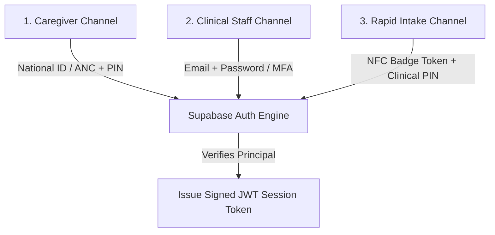
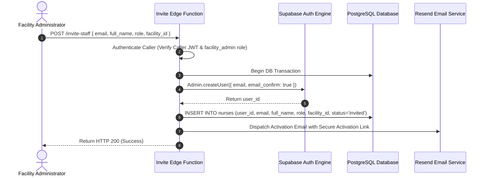

# TOTOAFYA DIGITAL — AUTHENTICATION LIFECYCLE SPECIFICATION

**Document ID:** `DOC-SEC-AUTH-05`  
**Version:** `1.0.0-PROD-SPEC`  
**Status:** `DRAFT FOR REVIEW / IMPLEMENTATION FROZEN`  
**Classification:** `CONFIDENTIAL — HEALTHCARE SECURITY ARCHITECTURE`  
**Target System:** TotoAfya Digital Production Platform  
**Location:** `docs/security/auth-authorization/05-AUTHENTICATION-LIFECYCLE-SPEC.md`  

---

## 1. Multi-Channel Authentication Protocols

TotoAfya Digital supports three distinct authentication channels tailored to operating environments in Kenyan healthcare facilities and rural communities.



### 1.1 Caregiver Authentication Protocol (National ID / ANC + PIN)

- **Legacy Mechanism `[PROVEN FROM CODE]`**: Client synthesized dummy emails `${identifier}@totoafya.org` and default passwords `toto_${pin}` and called `auth.signUp()` on-the-fly.
- **Target Contract**:
  - Synthetic client-side email generation is **STRICTLY ELIMINATED**.
  - Caregivers register via pre-registration at clinic intake (generating an activation code) OR direct registration.
  - Authentication uses Supabase Custom Phone/Identifier Auth OR a dedicated server-side authentication Edge Function (`/auth/caregiver-login`) that validates `national_id` or `anc_number` against hashed `pin_code` stored in `mothers`, returning a signed Supabase JWT.

### 1.2 Clinical Staff Authentication Protocol (Email + Password + MFA)

- Staff login using official healthcare email and strong password (minimum 12 characters, complexity enforced).
- Multi-Factor Authentication (TOTP / SMS OTP) is mandatory for `facility_admin`, `county_admin`, `moh_admin`, and `super_admin`.
- Successful login issues JWT containing `sub = auth.users.id`, `aud = 'authenticated'`, and `app_metadata = { role: 'nurse', facility_id: '...' }`.

### 1.3 Rapid Intake Channel (NFC Badge Token + Clinical PIN)

- For high-throughput maternal clinics, nurses tap an encrypted NFC badge (storing `badge_token`) and input a 4-digit `pin_code`.
- A dedicated Edge Function (`/auth/badge-login`) resolves the `badge_token` to `nurses.id`, verifies the bcrypt-hashed PIN, checks `status = 'active'`, and returns a short-lived session token.

---

## 2. Provisioning & Transactional Account Activation Contract

Account creation MUST be transactional across Supabase Auth (`auth.users`) and public database profiles (`mothers`, `nurses`).



### 2.1 Handling Partial Provisioning Failures

| Partial Failure Scenario | Failure Root Cause | System Recovery & Rollback Protocol |
| :--- | :--- | :--- |
| **Auth created / DB insert fails** | Foreign key violation, duplicate email in `nurses` | Rollback Auth creation (`auth.admin.deleteUser(user_id)`). Return `HTTP 500`. |
| **DB inserted / Auth creation fails**| Email format error, Supabase Auth outage | Rollback DB insert. Return `HTTP 400/500` with clear error details. |
| **Invitation dispatch fails** | Email API rate limit, invalid domain | Retain record in `status = 'pending_activation'`. Provide "Resend Invitation" button in admin panel. |
| **Duplicate National ID / ANC Number**| Mother already registered at another facility | Deny creation. Trigger patient lookup & facility transfer workflow. |
| **Duplicate Email** | Email already exists in `auth.users` or `nurses` | Deny creation (`HTTP 409 Conflict`). Prevent account duplicate creation. |

---

## 3. Session Lifecycle & Revocation Specification

Session tokens MUST be short-lived and subject to immediate administrative revocation.

### 3.1 Token Expiration Parameters

- **Access Token (`JWT`)**: Valid for **15 minutes**.
- **Refresh Token**: Valid for **7 days** (with sliding window extension on active use).
- **Activation Token / Reset Link**: Valid for **24 hours**.
- **Emergency Break-Glass Token**: Valid for **60 minutes max**.

### 3.2 Immediate Session Revocation Triggers

Existing active sessions MUST be immediately invalidated upon any of the following events:

1. **Role Mutation**: Staff member role changed (e.g., `nurse` -> `facility_admin`).
2. **Facility Re-Assignment**: Staff member transferred to another facility ID.
3. **Account Suspension**: Account status updated to `suspended` or `deactivated`.
4. **Password Reset**: User updates password or PIN.
5. **Administrative Logout**: Security officer triggers global session purge (`auth.admin.signOut(user_id)`).

```sql
-- Database Function for Immediate Token Invalidation
CREATE OR REPLACE FUNCTION revoke_user_sessions(p_user_id UUID)
RETURNS VOID AS $$
BEGIN
    UPDATE auth.users 
    SET updated_at = NOW() 
    WHERE id = p_user_id;
END;
$$ LANGUAGE plpgsql SECURITY DEFINER;
```

---
*End of Document 05 — Authentication Lifecycle Specification.*
